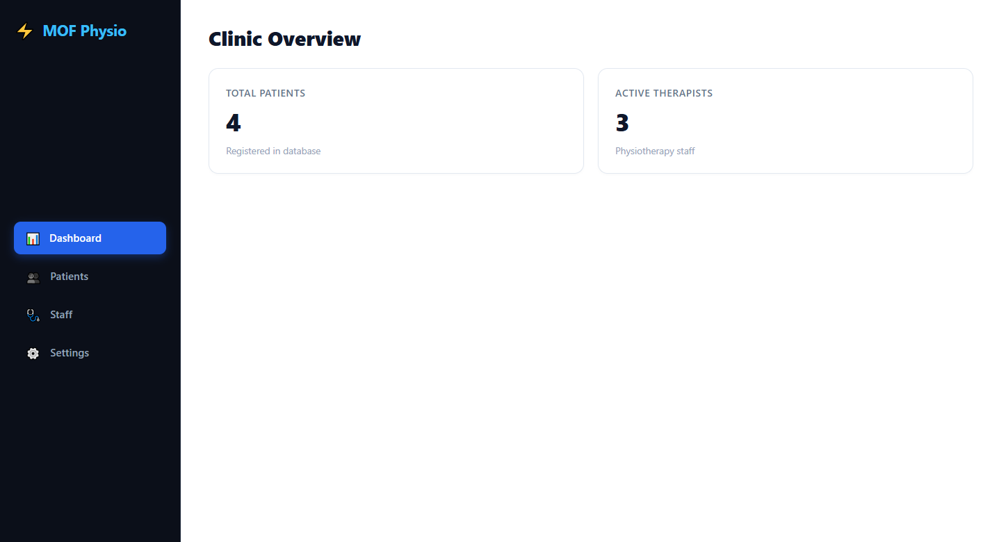
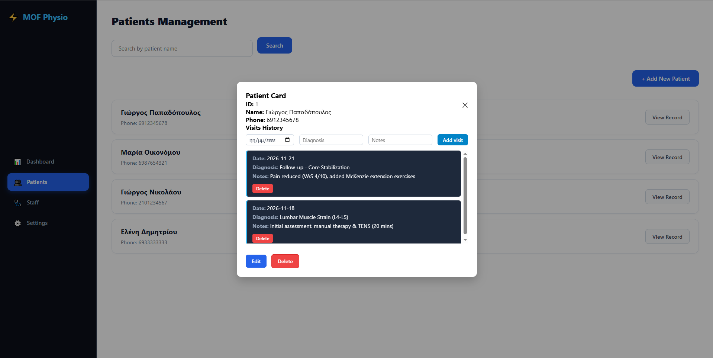
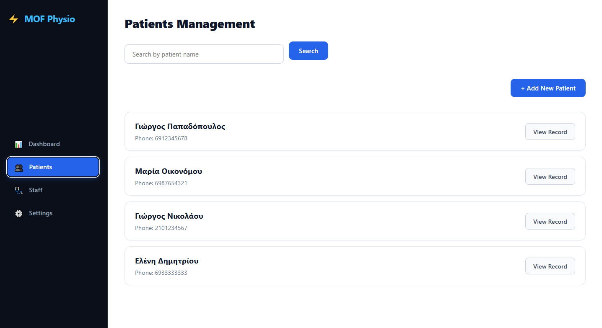
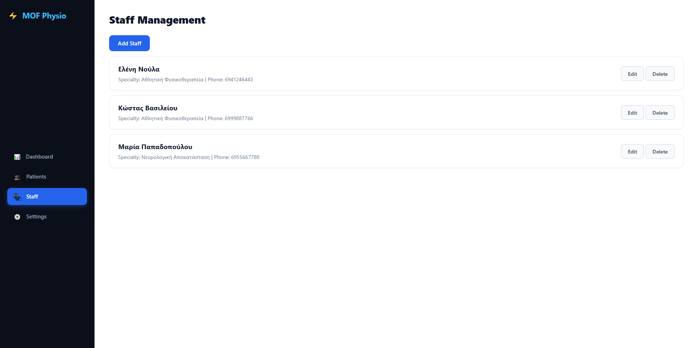

<div align="center">

# ⚡ MOF Physio — Clinic & Patient Management System

[](https://www.python.org/)
[](https://fastapi.tiangolo.com/)
[](https://www.sqlite.org/)
[](https://developer.mozilla.org/en-US/docs/Web/JavaScript)
[](LICENSE)

**A full-stack Single-Page Application (SPA) designed for physiotherapy clinics to streamline patient records administration, diagnostic visit tracking, and staff management.**

</div>

---

### Clinic Overview Dashboard



### Patients Management



### Patient Card & Medical Visit History



### Staff Management



---

## 📖 About This Project

This project was built for **learning purposes and portfolio demonstration** to practice designing a full-stack web architecture from scratch—combining a Python RESTful backend, a relational SQLite database with foreign key constraints, and an asynchronous, framework-free Vanilla JavaScript frontend.

---

## ✨ Key Features

- **Patient Records Management (CRUD):** Create, search in real time, view, update, and delete patient profiles.
- **Diagnostic Visit History (`1:N` Relationship):** Record and manage dated clinical visits, diagnoses, and treatment notes linked directly to each patient.
- **Staff Management (CRUD):** Add, edit, and remove physiotherapy staff members along with their specialties and contact details.
- **Single-Page Navigation:** Seamless switching between the Clinic Overview Dashboard, Patients Management, and Staff views without page reloads.
- **Interactive Native Modals:** Utilizes modern HTML5 `<dialog>` elements for clean, accessible forms and patient detail cards.
- **RESTful Backend & Validation:** FastAPI endpoints with strict Pydantic data validation and proper HTTP error handling.

---

## 🔌 REST API Endpoints

| Method   | Endpoint                    | Description                                      |
| :------- | :-------------------------- | :----------------------------------------------- |
| `GET`    | `/api/patients`             | Retrieve all patients or filter by query (`?q=`) |
| `POST`   | `/api/patients`             | Register a new patient                           |
| `GET`    | `/api/patients/{id}`        | Get specific patient details                     |
| `PUT`    | `/api/patients/{id}`        | Update patient information                       |
| `DELETE` | `/api/patients/{id}`        | Remove a patient record                          |
| `GET`    | `/api/patients/{id}/visits` | Retrieve visit history for a specific patient    |
| `POST`   | `/api/patients/{id}/visits` | Log a new diagnostic visit for a patient         |
| `DELETE` | `/api/visits/{id}`          | Delete a specific visit entry                    |
| `GET`    | `/api/staff`                | Retrieve all physiotherapy staff members         |
| `POST`   | `/api/staff`                | Add a new staff member                           |
| `PUT`    | `/api/staff/{id}`           | Update staff member details                      |
| `DELETE` | `/api/staff/{id}`           | Remove a staff member                            |

---

## 🧠 What I Learned

- Designing and exposing RESTful API endpoints (`GET`, `POST`, `PUT`, `DELETE`) with **FastAPI** and **Pydantic** schemas.
- Structuring relational database schemas in **SQLite** with `PRAGMA foreign_keys = ON` and parameterized SQL queries to prevent SQL injection.
- Building asynchronous client-server communication in **Vanilla JavaScript** using the `Fetch API` and `async/await`.
- Managing dynamic DOM rendering, real-time input filtering, and native HTML5 `<dialog>` modals without relying on external UI frameworks.

---

## 📂 Project Structure

```text
MOF-app/
│
├── ScreenShots/        # Application UI screenshots for documentation
│   ├── dashboard.png
│   ├── PatientsManage.png
│   ├── Patients.png
│   └── Staff.png
├── static/
│   ├── style.css       # Application styling, sidebar layout, cards, and modal UI
│   └── app.js          # Client-side state, Fetch API calls, search, and DOM rendering
├── main.py             # FastAPI application, static file mounting, and REST API endpoints
├── database.py         # SQLite connection, table initialization, and CRUD helper functions
├── index.html          # Single-page HTML5 layout and native <dialog> modals
├── mof.db              # Local SQLite database (auto-generated, git-ignored)
├── .gitignore
├── LICENSE             # MIT License
└── README.md           # Project documentation
```
